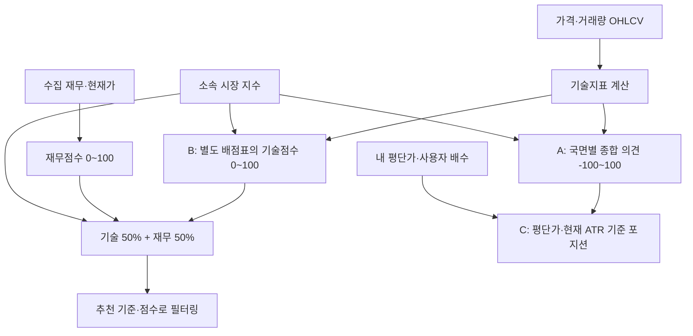

# QUANT 규칙 기반 매수·매도 의견 알고리즘

> 작성 기준일: 2026-11-20, Asia/Seoul  
> 대상: [QUANT 주식 분석 대시보드](https://nowjay.github.io/quant-stock-dashboard/)  
> 분석 기준 커밋: `fab5dc32568c5891a6d95d8a1e3f0691072cba1e`  
> 목적: 현재 구현된 의견 계산 규칙을 설명하고, 배점·분기·예외·검증 범위를 재현 가능하게 기록한다.

이 문서는 현재 구현을 설명하는 명세다. 새로운 투자 전략이나 매매 권고를 제안하는 문서는 아니다. 앞선 사이트 분석에서 배포본의 `scoring.js`, `signal.js`, `position.js`, `fundamentals.js`, `analysis.js`, `value.js`, `app.js`, `screener.js`가 로컬 파일과 바이트 단위로 같은 것을 확인했다. 이후 사이트나 코드가 변경되면 이 문서도 갱신해야 한다.

## 목차

1. [전체 구조와 핵심 구분](#1-전체-구조와-핵심-구분)
2. [입력 데이터와 분석 주기](#2-입력-데이터와-분석-주기)
3. [공통 지표·기호·반올림](#3-공통-지표기호반올림)
4. [알고리즘 A: 차트 기반 종합 의견](#4-알고리즘-a-차트-기반-종합-의견)
5. [공통 보정: 캔들 신호](#5-공통-보정-캔들-신호)
6. [공통 보정: 추세추종 신호](#6-공통-보정-추세추종-신호)
7. [공통 보정: 시장 급락](#7-공통-보정-시장-급락)
8. [알고리즘 B: 기술점수 100점](#8-알고리즘-b-기술점수-100점)
9. [알고리즘 B: 재무점수 100점](#9-알고리즘-b-재무점수-100점)
10. [알고리즘 B: 종합 신호와 추천 종목](#10-알고리즘-b-종합-신호와-추천-종목)
11. [알고리즘 C: 평단가 기준 포지션 판단](#11-알고리즘-c-평단가-기준-포지션-판단)
12. [데이터 품질과 판단 보류](#12-데이터-품질과-판단-보류)
13. [진행 중인 봉과 갱신·캐시](#13-진행-중인-봉과-갱신캐시)
14. [전망·목표가·설명 문구와의 관계](#14-전망목표가설명-문구와의-관계)
15. [신호 신뢰도 백테스트](#15-신호-신뢰도-백테스트)
16. [계산 예시](#16-계산-예시)
17. [해석상 한계와 구현상 주의점](#17-해석상-한계와-구현상-주의점)
18. [검증 결과와 코드 위치](#18-검증-결과와-코드-위치)

## 1. 전체 구조와 핵심 구분

### 1.1 규칙 기반 시스템의 의미

확인한 의견 계산 경로는 브라우저의 JavaScript에서 실행된다. 정해진 기술지표, 가중치, 점수 구간과 조건문으로 결과를 만든다. 화면의 명칭은 ‘AI 분석’, ‘AI 가치분석’이지만, 해당 의견 계산 경로에서 외부 LLM 호출이나 학습된 머신러닝 모델을 사용하지 않는다.

같은 입력과 설정을 넣으면 같은 결과가 나온다. **점수는 조건 충족 정도이며 상승 확률이 아니다.** 예를 들어 종합 신호 80점은 ‘80% 확률로 상승한다’는 의미가 아니다.

### 1.2 서로 다른 세 가지 판단

| 구분 | 화면에서 보는 결과 | 판단 목적 | 점수·출력 | 핵심 코드 |
|---|---|---|---|---|
| A | 종합 의견, 기술적 점수 게이지 | 현재 차트의 방향과 강도 평가 | −100~+100, 5단계 의견 | `QT.Scoring.at()` |
| B | 종합 매수 신호, 가치분석, 추천 종목 | 기술적 상태와 재무 매력도를 합산 | 0~100, 5단계 의견 | `QT.Signal.tech()`, `QT.Fund.analyze()`, `QT.Signal.combine()` |
| C | 내 포지션 | 내 평단가 기준 손절·익절·추가 매수 조건 판단 | 손절 / 익절 / 추가 매수 가능 / 보유 | `QT.Position.judge()` |

**B의 기술점수는 A를 0~100점으로 바꾼 값이 아니다.** 서로 다른 배점표를 쓴다. C는 A의 **일봉 점수**를 추가 매수 조건 중 하나로 사용하지만, A나 B의 등급을 바꾸지 않는다.



## 2. 입력 데이터와 분석 주기

### 2.1 가격·재무 데이터

| 데이터 | 사용처 | 구현·README에 기재된 출처와 처리 |
|---|---|---|
| 일봉 시가·고가·저가·종가·거래량 | A, B의 기술, C의 ATR | 국내는 공공데이터포털 금융위원회 시세가 기본. 연결 시 토스 실제 일봉·체결을 이어 붙인다. 번들 일봉도 사용한다. |
| 미국 일봉 | 기술적 분석 | Yahoo Finance 번들, 토스 연결 시 실제 일봉 보강 |
| 현재가 | 재무 배수, 스크리너 시세 | 연결·수집 상태에 따른 실제 체결 또는 수집 종가 |
| 국내 재무 | B의 재무 | 네이버 금융·WiseReport 수집 데이터 |
| 미국 재무 | B의 재무 | nasdaq.com 수집 데이터 |
| 소속 시장 지수 | 시장 급락 상한 | `QT.Markets.benchmark()`가 제공하는 지수 일봉·시세 |
| 사용자 평단가·수량·ATR 배수 | C | 브라우저 `localStorage` |

공공데이터 기본 모드는 실시간 분석과 같지 않다. README상 전 영업일 시세가 다음 영업일 오후에 공개되며, 배포 워크플로는 평일 13:40·17:30 KST에 수집·배포하도록 설정되어 있다. **예약 실행 설정은 실제 수집 성공이나 데이터 최신성을 보장하지 않는다.**

실제 일봉이 없는 종목은 차트 표시용 과거 경로를 생성할 수 있지만, 그 경로로 기술 의견·기술 신호·목표가를 제시하지 않도록 별도 제어한다.

### 2.2 화면마다 사용하는 봉

| 항목 | 계산 기준 |
|---|---|
| A의 상단 종합 의견·지표 리포트 | 일봉 기본. 주봉·월봉 선택 시 해당 봉 |
| 1분·5분 차트 선택 시 A | 분봉이 아닌 일봉 |
| 한눈에 보기의 종합 의견 | 일봉 |
| B의 기술점수·종합 매수 신호·추천 종목 | 항상 일봉 |
| C의 포지션 판단 | 일봉 분석의 가격·ATR·점수·시장 상태 |
| 단기·중기 전망, 목표주가, 신호 백테스트 | 일봉 |

주봉·월봉에 적용되는 `20`, `50`, `200`은 실제로 **20봉·50봉·200봉**이다. 코드·화면의 일부 이름에 ‘일선’이 남아 있어도 주봉에서는 20주선, 월봉에서는 20개월선에 해당한다.

## 3. 공통 지표·기호·반올림

### 3.1 기호

| 기호 | 의미 |
|---|---|
| `i` | 분석할 봉의 인덱스. 현재 분석에서는 마지막 봉 |
| `p` | 해당 봉 종가. 진행 중이면 마지막으로 반영된 가격 |
| `MA20`, `MA50`, `MA200` | 종가의 20·50·200봉 단순이동평균 |
| `pct(a,b)` | `(a−b) / b × 100` |
| `clamp(x,a,b)` | 값을 `[a,b]` 범위로 제한 |
| `t` | ADX를 0~1로 바꾼 추세 강도 |
| `dir` | 추세 방향. 상승 `+1`, 하락 `−1` |
| `e` | 거래량·캔들·채널 돌파에 사용할 마지막 완료 봉 |

### 3.2 지표 설정

| 지표 | 설정·산식 요약 |
|---|---|
| SMA | 종가 단순평균. 점수에는 주로 20·50·200봉 사용 |
| EMA | 첫 기간의 SMA로 시작, 평활계수 `2/(기간+1)` |
| RSI | 14봉, Wilder 평활. 상승·하락이 모두 없으면 50, 하락만 없으면 100 |
| MACD | EMA 12 − EMA 26, 시그널 EMA 9, 히스토그램 = MACD − 시그널 |
| Stochastic | 14봉 고저 범위 내 종가 위치를 3봉 SMA로 평활한 값 |
| CCI | 20봉, 대표가격 `(고가+저가+종가)/3`, 계수 0.015 |
| Williams %R | 14봉, 범위 −100~0 |
| MFI | 14봉 대표가격과 거래량으로 양·음 자금흐름 계산 |
| ADX·DMI | 14봉, Wilder 평활 |
| ATR | 14봉 True Range의 Wilder 평활. True Range는 고저폭과 전봉 종가 대비 갭 중 최댓값 |
| OBV | 전봉보다 종가 상승 시 거래량을 더하고, 하락 시 빼고, 같으면 유지 |
| 가격 채널 | 현재 봉을 제외한 직전 20봉 최고 고가·최저 저가 |
| 볼린저 밴드 | 20봉 SMA ± 2 표준편차. 종합 의견 A의 직접 점수 항목에는 없고 전망·목표가 등에서 사용 |

지표 계산 초반의 미확정 구간은 보통 `null`이다. 점수 엔진별로 누락값을 다루는 방식은 다르다.

### 3.3 반올림의 차이

- A의 기본점수, 재무 건전성, B의 종합점수는 JavaScript `Math.round()`를 쓴다.
- 캔들·추세추종 가감과 B의 신호 가감은 `sign(x) × round(abs(x))`로 0 기준 대칭 반올림한다. 따라서 −2.5는 −3이 된다.
- A의 기본점수에서 `Math.round(-2.5)`는 −2가 된다. 모든 단계의 반올림이 같다고 가정하면 재현 시 1점 차이가 날 수 있다.

## 4. 알고리즘 A: 차트 기반 종합 의견

근거: `assets/core/scoring.js`의 `at()`, `osc()`, `verdictOf()`.

### 4.1 추세 강도·방향·국면

```text
t = clamp((ADX − 15) / 20, 0, 1)
ADX가 없으면 t = 0.3

+DI와 −DI가 모두 있으면:
    +DI ≥ −DI → dir = +1
    그 밖 → dir = −1
그렇지 않으면:
    MA50이 있고 p ≥ MA50 → dir = +1
    그 밖 → dir = −1
```

국면 이름은 별도 경계값으로 정한다.

| ADX | 표시 국면 |
|---|---|
| 없음 | 국면 판단 불가 `na` |
| 20 미만 | 횡보장 `range` |
| 20 이상 25 미만 | 약한 추세 `weak` |
| 25 이상 | 추세장 `trend` |

국면 이름은 단계식이지만 가중치는 `t`로 연속 변화한다. ADX 25에서 즉시 추세 최대 비중으로 바뀌는 것은 아니다.

### 4.2 추세 그룹: 각 항목을 −1~+1로 제한 후 평균

| 항목 | 제한 전 항목 점수 |
|---|---|
| 20봉선 대비 | `pct(p, MA20) / 3` |
| 50봉선 대비 | `pct(p, MA50) / 6` |
| 200봉선 대비 | `pct(p, MA200) / 10` |
| 이동평균선 배열 | `MA20 > MA50 > MA200`: +1, 완전 역배열: −1, 그 밖 `MA20 > MA50`: +0.3, 나머지: −0.3 |
| 50봉선 기울기 | `pct(MA50[i], MA50[i−20]) / 4` |
| MACD | 시그널 위 +0.6 / 그 외 −0.6, 여기에 히스토그램 증가 +0.4 / 그 외 −0.4. 히스토그램 비교값이 없으면 추가항 0 |
| ADX·DMI | `dir × t` |

예를 들어 주가가 MA20보다 1.5% 높으면 첫 항목은 +0.5다. 3% 이상 높으면 +1로 제한된다. MACD가 시그널과 정확히 같으면 ‘위’ 조건을 충족하지 않아 −0.6을 쓴다. 히스토그램도 전봉과 같으면 증가가 아닌 쪽으로 처리한다.

유효한 항목만 평균한다. MA200이 없으면 관련 항목을 0점으로 넣지 않고 그룹 평균에서 제외한다.

### 4.3 모멘텀 그룹

다섯 오실레이터를 공통 함수 `osc()`로 평가하고, 10봉 수익률 점수를 함께 평균한다.

| 지표 | 공통 함수에 넣는 값 `v` | 상단 `hi` | 하단 `lo` | 중심 `mid` |
|---|---|---:|---:|---:|
| RSI | RSI | 70 | 30 | 50 |
| Stochastic | 평활된 Stochastic | 80 | 20 | 50 |
| CCI | `(CCI+200)/4` | 75 | 25 | 50 |
| Williams %R | `%R+100` | 80 | 20 | 50 |
| MFI | MFI | 80 | 20 | 50 |

CCI의 위 변환은 점수 함수에 넣기 위한 선형 변환이며, 원래 CCI를 0~100으로 잘라내는 처리는 아니다.

**횡보 해석 `R`:**

```text
v > hi → R = −1
v < lo → R = +1
그 밖 → R = 0
```

상단·하단에 정확히 같은 값은 이 분기에서 0이다.

**추세 해석 `Q`:** 아래에서 위부터 처음 맞는 조건을 적용한다.

| 추세 방향 | 조건 | Q |
|---|---|---:|
| 상승 | `v > hi+(100−hi)×0.5` | −0.4 |
| 상승 | 위 조건 아님, `v ≥ mid` | +0.6 |
| 상승 | 위 조건 아님, `v < lo` | −0.2 |
| 상승 | 나머지 | −0.3 |
| 하락 | `v < lo×0.5` | +0.4 |
| 하락 | 위 조건 아님, `v ≤ mid` | −0.6 |
| 하락 | 위 조건 아님, `v > hi` | +0.2 |
| 하락 | 나머지 | +0.3 |

```text
오실레이터 항목 점수 = t × Q + (1−t) × R
10봉 수익률 항목 점수 = clamp(pct(p, 종가[i−10]) / 6, −1, 1)
```

이 구조 때문에 RSI 75도 추세에 따라 해석이 다르다. 횡보 해석에서는 −1이지만, 강한 상승 추세 해석에서는 +0.6이다. RSI 85를 **초과**하면 상승 추세에서도 −0.4가 된다.

### 4.4 거래량 그룹

마지막 봉이 진행 중이면 거래량 그룹은 바로 전 봉 `e=i−1`까지 계산한다. 완료된 봉이면 `e=i`다.

```text
V20 = e까지 최근 20봉 평균 거래량
V5  = e까지 최근 5봉 평균 거래량

OBV 항목 = clamp(2 × (OBV[e]−OBV[e−20]) / (V20×20), −1, 1)
q = V5 / V20
r5 = pct(종가[e], 종가[e−5])

거래량 동반 항목 =
    q > 1.15이면 sign(r5) × min(1, q−1)
    그 밖에는 0
```

`V20 > 0`이고 `e ≥ 20`일 때만 두 항목을 넣는다. 두 항목을 평균해 거래량 그룹 점수를 만든다. 거래량이 늘어도 최근 5봉 가격이 하락하면 음수로 반영한다.

### 4.5 그룹 가중치와 기본점수

```text
wTrend    = 0.30 + 0.25 × t
wMomentum = 0.45 − 0.20 × t
wVolume   = 0.25

W = 유효한 그룹의 가중치 합
base = clamp(round(125 × Σ(그룹점수 × 그룹가중치) / W), −100, 100)
```

유효한 그룹이 하나도 없으면 기본점수는 0이다.

**주의: 코드의 가중치 합은 항상 1이 아니다.** 세 그룹이 모두 유효할 때 합은 `1+0.05×t`다. 따라서 아래의 ‘코드 가중치’를 그대로 최종 백분율로 읽으면 안 된다.

| 상태 | t | 코드 가중치: 추세 / 모멘텀 / 거래량 | 정규화한 실제 비중 |
|---|---:|---|---|
| ADX ≤ 15 | 0 | 0.30 / 0.45 / 0.25 | 30.00% / 45.00% / 25.00% |
| ADX = 25 | 0.5 | 0.425 / 0.35 / 0.25 | 약 41.46% / 34.15% / 24.39% |
| ADX ≥ 35 | 1 | 0.55 / 0.25 / 0.25 | 약 52.38% / 23.81% / 23.81% |

거래량 그룹이 없으면 그 가중치를 제외한 나머지 합으로 다시 나눈다. 그룹 수나 지표 수를 단순히 세는 다수결이 아니다.

### 4.6 최종점수와 의견

```text
own = clamp(base + 캔들 가감 + 추세추종 가감, −100, 100)
score = 시장 급락이면 min(own, 54), 그 밖에는 own
```

| 정수 점수 | 의견 | 내부 등급 |
|---|---|---:|
| 55~100 | 강력 매수 | +2 |
| 18~54 | 매수 | +1 |
| −17~17 | 중립 | 0 |
| −54~−18 | 매도 | −1 |
| −100~−55 | 강력 매도 | −2 |

화면의 ‘매수 지표 수’는 개별 항목 `v > 0.2`, ‘매도 지표 수’는 `v < −0.2`, 나머지는 중립으로 집계한 설명용 숫자다. 이 개수로 최종 의견을 결정하지 않는다.

## 5. 공통 보정: 캔들 신호

근거: `assets/core/candles.js`의 `read()`, `at()`.

### 5.1 판정에 쓰는 기준

캔들은 완료된 봉까지 판정한다. 각 봉의 판정 기준 ATR은 해당 봉 **직전 봉의 ATR**이다.

```text
봉 길이 = 고가 − 저가
몸통 = abs(종가 − 시가)
위꼬리 = 고가 − max(시가, 종가)
아래꼬리 = min(시가, 종가) − 저가
직전 흐름 = (직전 봉 종가 − 6봉 전 종가) / 직전 ATR

직전 흐름 ≥ 1 → 상승 뒤
직전 흐름 ≤ −1 → 하락 뒤
```

인덱스 6 미만, 직전 ATR이 양수가 아님, 봉 길이가 양수가 아님 중 하나면 해당 봉의 신호 목록은 비어 있다.

### 5.2 연속 양봉·음봉

- `종가−시가` 부호가 같은 봉이 3개 이상 연속되고, 시작 전 종가 대비 끝 종가도 같은 방향으로 움직여야 한다.
- 시가와 종가가 같은 봉은 연속을 끊는다.
- 3연속은 세기 0.6, 4연속 이상은 0.8이다.
- 20봉선 위의 연속 음봉, 20봉선 아래의 연속 양봉은 그대로 반영한다.
- 나머지는 세기를 절반으로 줄인다. MA20이 없을 때도 그대로 반영하는 조건을 충족하지 못해 절반이다.
- 방향은 양봉 +, 음봉 −다.
- 최근 세 봉의 종가가 차례로 같은 방향으로 움직이고 몸통이 모두 0.3 ATR 이상이면 적삼병·흑삼병이라는 이름을 붙이지만, 이 이름 자체가 추가 점수를 만들지는 않는다.

### 5.3 꼬리 패턴

| 조건 | 방향·세기 |
|---|---|
| 봉 길이 ≥ 0.7 ATR, 위꼬리 ≥ 봉 길이의 50%, 위꼬리 ≥ 아래꼬리의 2배, 직전 하락 흐름이 아님 | 매도 방향. 상승 뒤이면 0.8, 그 밖 0.5 |
| 위꼬리 조건이 성립하지 않고, 봉 길이 ≥ 0.7 ATR, 아래꼬리 ≥ 봉 길이의 50%, 아래꼬리 ≥ 위꼬리의 2배, 직전 상승 흐름이 아님 | 매수 방향. 하락 뒤이면 0.8, 그 밖 0.5 |

하락 뒤 긴 위꼬리, 상승 뒤 긴 아래꼬리는 이 규칙의 점수 신호에서 제외한다.

### 5.4 몸통 패턴

| 패턴 | 주요 조건 | 방향·세기 |
|---|---|---|
| 상승 장악형 | 전봉 음봉, 현재 양봉, 현재 몸통이 전봉 몸통을 감싸고 더 큼, 직전 흐름 < 0 | +0.8 |
| 하락 장악형 | 전봉 양봉, 현재 음봉, 현재 몸통이 전봉 몸통을 감싸고 더 큼, 직전 흐름 > 0 | −0.8 |
| 장대봉 | 장악형이 아니면서 몸통 ≥ 1.5 ATR, 몸통 ≥ 봉 길이의 70% | 양봉 +0.5 / 음봉 −0.5 |

장악형의 직전 흐름 조건은 부호만 본다. 꼬리 패턴의 ‘1 ATR 이상 움직임’ 조건과 다르다.

도지는 꼬리 신호가 없고 몸통이 봉 길이의 10% 미만이며 직전 흐름 절댓값이 1 이상일 때 표시한다. 도지는 점수에 넣지 않는다.

### 5.5 최근 3봉 합산

```text
연속 봉 = 마지막 완료 봉의 상태만 사용
꼬리 합 = clamp(최근 3봉의 부호 있는 꼬리 세기 × [1, 0.6, 0.3] 합, −1, 1)
몸통 합 = clamp(최근 3봉의 부호 있는 몸통 세기 × [1, 0.6, 0.3] 합, −1, 1)

캔들 값 = clamp(연속 봉 값 + 꼬리 합 + 몸통 합, −1, 1)
A의 캔들 가감 = 대칭 반올림(10 × 캔들 값)
```

서로 반대되는 신호는 상쇄된다. A에는 최대 ±10점, B에는 추세추종과 합친 뒤 절반 크기로 반영한다.

## 6. 공통 보정: 추세추종 신호

근거: `assets/core/scoring.js`의 `signals()`, `assets/core/indicators.js`의 `crossAt()`.

| 항목 | 상승 신호 | 하락 신호 | 탐색·감쇠 기간 |
|---|---|---|---:|
| 단·중기 이평 교차 | MA20이 MA50 상향 교차 | 하향 교차 | 최근 20봉 |
| 장기 이평 교차 | MA50이 MA200 상향 교차 | 하향 교차 | 최근 60봉 |
| 가격 채널 돌파 | 종가 > 직전 20봉 최고 고가 | 종가 < 직전 20봉 최저 저가 | 최근 10봉 |

교차는 직전 차이가 0 이하에서 현재 양수로 바뀌면 상승, 직전 차이가 0 이상에서 현재 음수로 바뀌면 하락이다. 각 항목에서 가장 최근 신호 하나를 사용한다. 채널 돌파는 경계와 같으면 성립하지 않는다.

```text
항목 값 = 방향 × 0.6 × (1 − 경과 봉 수 / 감쇠 기간)
F = clamp(세 항목 값의 합, −1, 1)
국면 계수 = 0.5 + 0.5 × t
A의 추세추종 가감 = 대칭 반올림(10 × F × 국면 계수)
```

횡보 성격이 강하면 최대 ±5점, 강한 추세이면 최대 ±10점이다. 발생 당일의 개별 항목 세기는 0.6이며, 여러 항목의 합은 ±1로 제한한다.

**진행 중 봉의 차이:** 캔들·채널 돌파는 직전 완료 봉까지만 본다. 이동평균선 교차는 `i`까지 계산하므로 진행 중인 마지막 봉에서 나타난 교차가 점수에 들어갈 수 있다. ‘모든 신호가 봉 마감 뒤에만 반영된다’고 해석하면 안 된다.

## 7. 공통 보정: 시장 급락

근거: `assets/core/markets.js`의 `benchmark()`, `assets/core/scoring.js`의 `marketAt()`.

### 7.1 종목별 비교 지수

| 종목의 `market` | 비교 지수 |
|---|---|
| KOSPI | 코스피 |
| KOSDAQ | 코스닥 |
| NASDAQ100 | 나스닥 종합지수 `IXIC` |
| S&P500 | S&P 500 `SPX` |
| US | 나스닥 종합지수 `IXIC` |
| ETF 또는 매핑되지 않은 시장 | 없음 |

`NASDAQ100` 분류라고 해서 나스닥100 지수로 보정하는 것은 아니다. 코드의 매핑은 `IXIC`다. ETF는 인버스·채권·해외지수형 등 상장 시장과 다른 방향으로 움직이는 상품을 고려해 제외한다.

### 7.2 급락 조건

```text
d1 = 지수 전 거래일 대비 등락률
d3 = (지수 현재 종가 / 3거래일 전 종가 − 1) × 100
risk = (d1 ≤ −2%) OR (d3 ≤ −3%)
```

현재 분석에서는 날짜가 맞는 시세 등락률 `mk.r`이 있으면 당일 등락률에 우선 사용한다. 그렇지 않으면 지수 일봉으로 계산한다. 3거래일 누적은 일별 등락률의 단순 합이 아닌 가격 비율이다.

| 대상 | 급락 때 처리 |
|---|---|
| A 종합 의견 | `min(종목 자체 점수, 54)` |
| B 기술점수 | `min(기술 raw, 79)` |
| B 기술·재무 종합점수 | 시장 상한 전 기술 raw로 평균한 뒤 `min(종합 own, 79)` |
| B 재무점수 자체 | 그대로 유지 |
| C 추가 매수 | 다른 조건이 좋아도 허용하지 않음 |

이는 강력 매수만 거두는 상한이다. 원래 매도·중립·일반 매수인 점수를 일괄 차감하거나 매도로 바꾸지 않는다.

### 7.3 지수 데이터가 없거나 오래된 경우

- 지수 이력이 2개 미만이거나 이전 종가가 양수가 아니면 시장 상태를 산출하지 않는다.
- 과거 시점에서는 해당 날짜 이하인 가장 최근 지수를 선택한다. 그보다 미래의 지수는 사용하지 않는다.
- 선택한 지수 날짜가 전달된 판단 기준일보다 달력 기준 5일 넘게 오래되면 `null`을 반환한다.
- 현재 모드의 일부 호출은 판단 기준일을 `null`로 넘기므로 이 날짜 차이 검사가 실행되지 않는다. 모든 호출에서 ‘오늘 기준 5일 이내’를 보장하는 검사가 아니다.
- 지수 판단이 `null`이면 급락 상한은 적용하지 않는다. 이는 위험이 없음을 확인했다는 의미가 아니라 시장 보정을 생략했다는 뜻이다.

## 8. 알고리즘 B: 기술점수 100점

근거: `assets/core/signal.js`의 `tech()`.

실제 일봉 60개 이상이고 데이터 품질이 `low`가 아닐 때 호출하는 것이 화면·스크리너의 기본 흐름이다. 함수 자체도 60봉 미만이면 `null`을 반환한다.

### 8.1 이동평균선: 각 5점, 총 25점

| 조건 | 충족 시 |
|---|---:|
| 주가 > MA20 | 5 |
| MA20 > 5일 전 MA20 | 5 |
| MA20 > MA50 | 5 |
| MA50 > MA200 | 5 |
| 주가 > MA200 | 5 |

MA200이 없으면 마지막 두 조건을 다음으로 대체한다.

| 원래 조건 | 대체 조건 |
|---|---|
| MA50 > MA200 | MA50 > 10일 전 MA50 |
| 주가 > MA200 | 주가 > MA50 |

따라서 MA200이 없다고 이동평균 배점의 최고점이 자동으로 15점으로 줄지는 않는다. 비교는 모두 **초과**이므로 같으면 점수를 받지 못한다.

### 8.2 RSI: 총 25점

`trendUp`은 `ADX ≥ 25`이고 `+DI > −DI`일 때다. A의 방향 판정에서 사용하는 `+DI ≥ −DI`와 등호 처리가 다르다.

| 현재 RSI r | 기본점수 z |
|---|---:|
| r < 30 | 18 |
| 30 ≤ r < 40 | 5일 전 RSI가 30 미만이면 20, 그 밖 12 |
| 40 ≤ r < 50 | 12 |
| 50 ≤ r < 60 | 16 |
| 60 ≤ r < 70 | 20 |
| 70 ≤ r < 80 | `trendUp`이면 17, 그 밖 11 |
| r ≥ 80 | `trendUp`이면 10, 그 밖 5 |

```text
RSI점수 = clamp(z + 추가점수, 0, 25)
추가점수 = 현재 RSI > 5일 전 RSI이고 현재 RSI < 80이면 5, 그 밖 0
```

RSI가 없으면 0점이다. 과매도 자체에도 18점을 주므로 ‘RSI가 낮을수록 무조건 낮은 점수’가 아니다.

### 8.3 MACD: 총 25점

| 조건 | 점수 |
|---|---:|
| MACD > 시그널 | 10 |
| 히스토그램 > 전일 히스토그램 | 5 |
| MACD > 0 | 5 |
| 최근 10봉 내 가장 최근 MACD·시그널 교차가 상승 교차 | 5 |

MACD나 시그널이 없으면 이 항목은 0점이다. 최근 상승 교차가 있더라도 그 뒤 하락 교차가 더 최근에 발생했다면 마지막 5점은 받지 못한다.

### 8.4 전일 피봇: 총 25점

항상 현재 일봉의 **직전 일봉** 고가 `H`, 저가 `L`, 종가 `C`를 쓴다.

```text
P  = (H+L+C)/3
R1 = 2P−L       S1 = 2P−H
R2 = P+(H−L)    S2 = P−(H−L)
```

| 현재가 위치 | 점수 |
|---|---:|
| p ≥ R2 | 25 |
| R1 ≤ p < R2 | 21 |
| P ≤ p < R1 | 14 |
| S1 ≤ p < P | 7 |
| p < S1 | 2 |

봉 길이가 0이면 일부 경계가 같아질 수 있으며, 이때는 위에서부터 먼저 맞는 분기를 쓴다. 가격이 같아도 반드시 중립점수 14점이 되는 것은 아니다.

### 8.5 신호 가감과 최종 기술점수

```text
sum = 이동평균점수 + RSI점수 + MACD점수 + 피봇점수
adj = 대칭 반올림((A의 캔들 가감 + A의 추세추종 가감) / 2)
raw = clamp(sum+adj, 0, 100)
score = 시장 급락이면 min(raw,79), 그 밖 raw
marketCut = raw−score
```

가감은 이론상 최대 ±10점이다. 다만 0~100 범위에서 잘린 만큼을 조정해 반환 객체의 `adj.pts = raw−sum`으로 다시 기록한다. 이 때문에 화면에 나타나는 가감은 최초 가감보다 작을 수 있다.

### 8.6 태그와 점수의 구분

골든크로스·정배열·RSI 과매도·피봇 돌파 같은 태그에는 `w`라는 표시 우선순위가 있다. **태그의 `w`를 기술점수에 추가하지 않는다.** 점수에 반영되는 공통 신호와 설명용 태그는 구분해야 한다.

## 9. 알고리즘 B: 재무점수 100점

근거: `assets/core/fundamentals.js`의 `analyze()`, `scoreOf()`, `health()`.

### 9.1 점수에 들어갈 재무값

```text
PER = 현재가 / EPS, EPS > 0일 때만 유효
PBR = 현재가 / BPS, BPS > 0일 때만 유효
ROE = EPS / BPS × 100, 둘 다 유효하고 BPS > 0일 때
```

EPS·BPS는 수집된 TTM 값을 먼저 쓰고, 없으면 추정치가 아닌 최신 연간 값을 사용한다. ROE를 위 식으로 계산할 수 없으면 최신 실제 연간 ROE를 사용한다. 화면의 ‘최근 4분기’ 문구가 모든 종목의 실제 계산 기간을 보장하지는 않는다.

영업이익 성장은 최신 실제 분기와 전년 같은 분기를 우선 비교한다. 비교값이 없으면 최근 실제 연간 두 기간을 비교한다. 추정치로 표시된 연간·분기 항목은 최신 실제 기간을 선택하는 과정에서 제외한다.

### 9.2 업종 비교값의 선택

- 국내 업종 PER은 수집된 WICS PER이 **1~100배 범위**면 우선 사용한다.
- 그렇지 않으면 수집 데이터에 있는 동종 기업 PER의 중앙값을 사용한다.
- PBR은 수집 동종 기업의 중앙값을 사용한다.
- 비교군은 자신을 제외하고 같은 통화만 포함한다.
- 국내는 `ind` 일치 업종, 다음으로 `mktInd` 일치 업종을 탐색한다. 미국은 `ind` 일치 업종, 다음으로 `sector` 일치 섹터를 탐색한다.
- 첫 비교군은 유효 종목 2개 이상, 다음 비교군은 3개 이상이어야 한다. PER·PBR은 각각 표본을 계산한다.
- 양수 EPS·BPS와 유효 현재가가 있어야 하며, PER 150배 이상·PBR 60배 이상은 비교 표본에서 제외한다.
- 시장 전체 중앙값으로 무조건 대체하지 않는다. 비교군이 없으면 절대 배수 구간을 쓴다.

따라서 ‘업종 평균’은 항상 시장 전체 업종의 완전한 모집단을 뜻하지 않는다. 수집된 일부 종목의 중앙값일 수 있다.

### 9.3 PER·PBR 상대 평가: 각각 25점

`q = 해당 종목 배수 / 업종 비교 배수`로 계산한다.

| q | 점수 |
|---|---:|
| q ≤ 0.50 | 25 |
| 0.50 < q ≤ 0.70 | 22 |
| 0.70 < q ≤ 0.85 | 18 |
| 0.85 < q ≤ 1.00 | 14 |
| 1.00 < q ≤ 1.20 | 9 |
| 1.20 < q ≤ 1.50 | 5 |
| q > 1.50 | 2 |

PER이 유효하지 않으면 0점이다. PBR이 유효하지 않아도 0점이다. PBR은 ROE가 음수이면 상대·절대 평가 결과를 모두 최대 8점으로 제한한다.

### 9.4 업종 비교값이 없을 때의 절대 평가

| PER 구간 | 점수 | PBR 구간 | 점수 |
|---|---:|---|---:|
| 8 이하 | 20 | 0.7 이하 | 20 |
| 8 초과 12 이하 | 16 | 0.7 초과 1 이하 | 16 |
| 12 초과 20 이하 | 11 | 1 초과 2 이하 | 11 |
| 20 초과 30 이하 | 6 | 2 초과 4 이하 | 6 |
| 30 초과 | 2 | 4 초과 | 2 |

절대 평가의 최고점은 각 20점이다. 업종 비교값 유무만으로도 받을 수 있는 최고점이 달라진다.

### 9.5 ROE: 25점

| ROE | 점수 |
|---|---:|
| 20% 이상 | 25 |
| 15% 이상 20% 미만 | 22 |
| 10% 이상 15% 미만 | 18 |
| 7% 이상 10% 미만 | 11 |
| 3% 이상 7% 미만 | 6 |
| 0% 이상 3% 미만 | 3 |
| 음수 또는 값 없음 | 0 |

### 9.6 영업이익 성장: 25점

| 전년 대비 상태 | 점수 |
|---|---:|
| 증가율 50% 이상 | 25 |
| 증가율 20% 이상 50% 미만 | 22 |
| 증가율 10% 이상 20% 미만 | 19 |
| 증가율 0% 초과 10% 미만 | 15 |
| 증가율 −10% 이상 0% 이하 | 8 |
| 증가율 −10% 미만 | 3 |
| 흑자 전환 | 22 |
| 적자 전환 | 0 |
| 적자 지속 | 1 |
| 비교 가능한 값 없음 | 0 |

상태 판정의 정확한 경계는 다음과 같다.

```text
전년 이익 ≤ 0, 현재 이익 > 0 → 흑자 전환
전년 이익 > 0, 현재 이익 ≤ 0 → 적자 전환
전년 이익 ≤ 0, 현재 이익 ≤ 0 → 적자 지속
그 밖 → (현재 이익−전년 이익) / 전년 이익 × 100
```

따라서 현재 이익이 정확히 0이어도 전년 값에 따라 ‘적자 전환’ 또는 ‘적자 지속’으로 분류될 수 있다. 여기서는 코드의 분기 명칭을 그대로 기록한다.

### 9.7 재무 건전성 점수

건전성은 별도 가중평균으로 계산하고, 재무점수에 감점 형태로 반영한다. 아래 계수는 0~1 값이다.

| 항목 | 기본 가중치 | 값의 구간 → 계수 |
|---|---:|---|
| 부채비율 | 30 | ≤50%: 1 / ≤100%: 0.85 / ≤150%: 0.62 / ≤200%: 0.42 / ≤300%: 0.20 / 그 초과: 0.06 |
| 이자보상배율 | 30 | ≥10: 1 / ≥5: 0.85 / ≥3: 0.62 / ≥1.5: 0.35 / ≥1: 0.18 / 그 미만: 0 |
| 유보율 | 20 | ≥1000%: 1 / ≥500%: 0.8 / ≥200%: 0.5 / ≥100%: 0.3 / 그 미만: 0.1 |
| 유동비율 | 20 | ≥200%: 1 / ≥150%: 0.8 / ≥100%: 0.5 / ≥80%: 0.25 / 그 미만: 0.1 |

각 행은 위에서부터 처음 맞는 구간을 쓴다.

```text
건전성 H = round(100 × Σ(유효 항목 가중치 × 계수) / Σ(유효 항목 가중치))
```

예외 처리:

- 값이 없는 항목은 가중평균에서 제외한다. 유효 가중치가 없으면 `H=null`이다.
- 금융업은 부채비율·이자보상배율을 가중치 0으로 제외하고 유동비율도 평가하지 않는다. 유보율이 있으면 그 항목은 남을 수 있다.
- 이자보상배율 값이 없지만 현금이 차입금보다 많은 것으로 판정되면 해당 항목을 계수 1로 대신한다. 화면 명칭은 ‘무차입’이지만, 코드 조건은 순현금 여부다.
- 미국 부채비율은 가능한 경우 `총부채 / 자본 × 100`을 사용하고, 이자보상배율은 TTM 값을 우선 사용한다. 미국 유보율은 사용하지 않는다.
- 국내 부채비율·유보율은 최신 실제 분기를 먼저 보고 없으면 이력 값으로 대체한다.

| H | 건전성 등급 | 재무점수 감점 |
|---|---|---:|
| 80 이상 | 매우 안정 | 0 |
| 65 이상 80 미만 | 안정 | 0 |
| 45 이상 65 미만 | 보통 | 0 |
| 30 이상 45 미만 | 주의 | 5 |
| 30 미만 | 위험 | 10 |
| 산출 불가 | 등급 없음 | 0 |

### 9.8 최종 재무점수

```text
fundRaw = PER점수 + PBR점수 + ROE점수 + 영업이익성장점수
fundScore = clamp(fundRaw−건전성감점, 0, 100)
```

**누락 처리가 일관된 방식은 아니다.** PER·PBR·ROE·성장 값 누락은 기본 항목에서 0점이 될 수 있지만, 건전성 항목 누락은 해당 가중치를 제외하며 건전성을 아예 못 구하면 감점 0이다. 따라서 낮은 재무점수에 데이터 부족이 섞일 수 있고, 건전성 감점이 없다고 재무가 안전하다는 뜻도 아니다.

## 10. 알고리즘 B: 종합 신호와 추천 종목

### 10.1 결합 순서

기술과 재무가 모두 있을 때만 진짜 종합점수 `total`을 계산한다.

```text
own = round(0.5 × 기술 raw + 0.5 × 재무 score)
total = 시장 급락이면 min(own,79), 그 밖 own
```

**급락으로 79점에 제한된 기술 score를 평균에 넣지 않는다.** 기술 raw와 재무 score로 먼저 평균한 뒤 종합 상한을 적용한다. 그래야 원래 강력 매수가 아닌 종합점수까지 불필요하게 내려가지 않는다.

### 10.2 등급표

| 점수 | 등급 |
|---|---|
| 80~100 | 강력 매수 |
| 65~79 | 매수 |
| 45~64 | 중립 |
| 30~44 | 매도 |
| 0~29 | 강력 매도 |

이 등급표는 B의 기술 단독·재무 단독 점수에도 사용한다. A의 −100~100 등급표와 혼용하지 않는다.

### 10.3 한쪽 데이터만 있는 경우

| 기술 | 재무 | 상세 화면·요약 띠 | 종합 기준 추천 목록 |
|---|---|---|---|
| 있음 | 있음 | 50:50 종합점수 | 평가 가능 |
| 있음 | 없음 | 기술점수·기술 등급, ‘기술만’ 표시 | 제외 |
| 없음 | 있음 | 재무점수·재무 등급, ‘재무만’ 표시 | 제외 |
| 없음 | 없음 | 판단 불가 또는 신호 띠 숨김 | 제외 |

‘종합 매수 신호’라는 카드 제목 아래에도 단독점수가 표시될 수 있다. 숫자뿐 아니라 ‘기술만·재무만’ 표시를 함께 읽어야 한다.

### 10.4 추천 종목 필터

근거: `assets/screener.js`의 `scoreOf()`, `paint()`.

1. 선택한 관심종목 또는 시장·종목 목록을 평가한다. 시장 목록에서는 재무 데이터, 실제 일봉, 국내 시총 상위 일봉 수집 대상 중 하나에 해당하는 종목을 기본 평가 대상으로 잡는다.
2. 기준이 기술이면 `tech.score`, 재무이면 `fund.score`, 종합이면 `combo.total`을 사용한다.
3. 해당 점수가 없으면 제외한다. 기술은 실제 일봉·품질 조건을 충족해야 한다.
4. ‘매수 이상 전체’는 65점 이상, ‘강력 매수만’은 80점 이상을 통과시킨다.
5. 선택 기준 점수 내림차순, 동점이면 종합점수 내림차순으로 정렬한다. 이 비교까지 같으면 별도의 추가 우열 규칙은 없다.

적정주가 상승 여력·기술적 목표가·태그는 카드의 추가 설명이다. 현재 필터 통과 기준은 선택한 점수이며, 목표가 상승 여력이 별도 가산점은 아니다. 재무 기준만 선택하면 시장 급락 중에도 재무 강력 매수 종목이 남을 수 있다.

## 11. 알고리즘 C: 평단가 기준 포지션 판단

근거: `assets/core/position.js`의 `judge()`, `assets/app.js`의 `posOf()`.

### 11.1 입력과 기본값

| 입력 | 내용 |
|---|---|
| avg | 사용자가 입력한 평단가 |
| price | 일봉 분석에서 사용하는 현재 가격 |
| atr | 일봉 분석의 ATR |
| score | 시장 보정 후 A의 일봉 점수 |
| market | 일봉 분석의 시장 상태 |
| rule.stop / rule.take | 손절·익절 ATR 배수 |
| qty | 선택 입력. 평가손익 금액 계산에만 사용 |

기본 손절 배수는 2, 익절 배수는 3이다. 사용자 배수는 0.5~10 범위에서 0.5 단위로 반올림·제한한다. 양수가 아닌 값이나 비유효 값이면 기본값을 쓴다. 설정은 모든 종목에 공통 적용된다.

### 11.2 손절·익절선

```text
stop = avg − stop배수 × atr
take = avg + take배수 × atr
```

코드에서 `stop`의 최소값을 0으로 제한하거나 두 선을 호가 단위로 반올림하는 처리는 없다. ATR이 아주 크면 계산상 손절선이 음수가 될 수도 있다.

### 11.3 판단 우선순위

```text
avg·price·atr 중 하나라도 양수가 아니면 → 판단값 null

price ≤ stop → 매도·손절
그 밖 price ≥ take → 매도·익절
그 밖 아래 3조건 모두 충족 → 추가 매수 가능
그 밖 → 보유
```

추가 매수의 세 조건:

| 조건 | 정확한 코드 기준 |
|---|---|
| 기술 의견 | `score`가 유효하고 `score ≥ 18` |
| 시장 | `market.risk`가 참이 아님 |
| 남은 손익비 | `take−price ≥ price−stop` |

마지막 조건은 두 선 사이에서 `남은 상승폭 / 남은 하락폭 ≥ 1`과 같다. 시장 상태가 `null`이어도 두 번째 조건은 통과한다. 재무점수·B의 종합점수는 추가 매수 조건에 들어가지 않는다.

### 11.4 ATR과 보조 표시

- ATR은 매수 당시 고정값이 아니라 **현재 분석 값**이다. 변동성이 커지면 손절·익절선이 평단가에서 멀어지고, 작아지면 가까워진다.
- 가격이 두 선 안에 있고 손절선 또는 익절선까지 0.5 ATR 이내이면 ‘근접’ 상태를 표시한다. 양쪽 모두 근접할 수 있는 설정에서는 손절 근접을 먼저 판정한다.
- 수익률은 `(price/avg−1)×100`, 수량이 양수일 때 평가손익 금액은 `(price−avg)×qty`다.
- 평단가·수량·배수는 `qt.pos.v1`로 해당 브라우저에 저장된다.
- 화면 호출부는 일봉 데이터 품질이 `low`이면 포지션을 판단하지 않는다.
- `Analysis.core()`는 실제 계산 ATR이 없거나 0이면 `가격×2%`를 분석용 ATR 대체값으로 사용한다. 따라서 C에 전달되는 `atr`이 항상 원시 ATR(14) 그대로라고 단정하면 안 된다.

## 12. 데이터 품질과 판단 보류

근거: `assets/core/analysis.js`의 `quality()`, `run()`, 화면의 `renderAnalysis()`, `techOf()`.

### 12.1 품질 등급

시작값은 `high`다. 여러 조건이 겹치면 `low`가 우선하며, `mid` 조건이 뒤에 나와도 다시 높아지지 않는다.

| 조건 | 품질 |
|---|---|
| 실제 가격 경로가 아님: `real=false` | low, 즉시 반환 |
| 일봉 60개 미만 | low |
| 일봉 60~119개 | mid |
| 일봉 120~199개 | mid |
| 최근 마지막 3봉 이상 거래량 0 | low, 거래량 양수 이력이 있는 시계열만 |
| 위 연속 조건이 아니면서 최근 최대 20봉 중 무거래 5봉 이상 | low |
| 위 조건이 아니면서 최근 최대 20봉 중 무거래 2봉 이상 | mid |
| 최근 최대 60개 전일 대비 수익률 중 절댓값 30.5% 초과가 존재 | mid |
| 위 경고가 없음 | high |

가격 급변 경고의 실제 문턱은 **30%가 아니라 30.5% 초과**다. 화면 설명은 ‘±30%를 넘는 급변’으로 표현한다. 이 검사는 국내에만 제한하는 시장 분기 없이 실행된다.

### 12.2 품질이 low이면

- A의 상단 의견은 ‘판단 보류’로 표시한다.
- 기술적 목표가를 만들지 않는다.
- B의 기술점수를 제공하지 않고, 기술·종합 기준 추천에서 제외한다.
- C의 손절·익절·추가 매수 판단을 보류한다.
- 실제 재무 데이터가 있으면 B에서 재무 단독 의견은 나올 수 있다.

내부 기술지표나 `core()` 점수 계산 자체가 전부 중단되는 구조는 아니다. 품질을 계산한 뒤 화면·호출부에서 의견을 숨기거나 사용하지 않게 한다.

### 12.3 품질 등급이 보장하지 않는 것

- `high`는 입력이 이 검사에 걸리지 않았다는 뜻이다. 미래 예측력이 높다는 뜻이 아니다.
- 품질 검사는 일봉 기준이다. 일봉 2년치가 충분하더라도 주봉·월봉의 MA200은 없을 수 있다.
- 거래량이 한 번도 양수가 아니었던 시계열은 무거래 경고에서 제외한다. 데이터가 모두 0인 경우를 언제나 잡아낸다는 보장은 없다.
- 이 함수에는 종목 일봉의 마지막 날짜와 오늘 날짜를 비교해 오래된 종목 데이터를 일괄 보류하는 검사가 없다. 시장 지수의 날짜 검사와 구분해야 한다.
- 품질이 `mid`여도 점수를 일괄 감점하지는 않는다. 경고와 일부 지표 제외·대체가 적용된다.
- 최근 기술 신호 목록 `events`는 실제 경로 여부로 제어한다. 실제 경로이면서 품질이 low인 모든 경우에 신호 목록까지 무조건 비우는 구조는 아니다.

## 13. 진행 중인 봉과 갱신·캐시

### 13.1 진행 중 봉 처리

| 계산 항목 | 마지막 봉이 진행 중일 때 |
|---|---|
| A의 가격·이평·MACD·모멘텀 | 진행 중인 마지막 봉의 값 사용 가능 |
| A의 거래량 그룹 | 직전 완료 봉까지 사용 |
| 캔들 신호 | 직전 완료 봉까지 사용 |
| 20봉 채널 돌파 | 직전 완료 봉까지 사용 |
| 이평선 교차 | 진행 중인 봉까지 사용 가능 |
| B의 기본 기술 4항목 | 진행 중인 일봉의 값 사용 가능 |
| C의 가격·ATR | 현재 일봉 분석 값 사용 |

거래량 그룹에서 현재 봉을 제외하더라도, 모멘텀 그룹의 MFI는 현재 지표 배열 값을 사용한다. 따라서 모든 거래량 관련 계산에서 진행 중 거래량을 완전히 제외하는 것은 아니다.

실시간 가격에 따라 일부 점수·교차·포지션 판단은 장중 변할 수 있다. 진행 중 여부는 종목 통화에 따른 장 마감 시각과 주·월 버킷 등을 이용해 판단한다.

### 13.2 스크리너 캐시

`QT.Signal.evaluate()`는 종목별 평가 결과를 캐시한다. 키에는 종목 코드, 시세 가격, 실제 경로 여부, 진행 중 봉 여부, 재무 갱신값, 급락 상태의 지수 키, 일봉 개수·마지막 날짜·마지막 종가 등이 들어간다.

시장 등락 수치 자체의 매 변화보다 **급락 여부 전환**이 재평가에 중요하다. 키가 같으면 이전 결과를 그대로 반환한다. 마지막 봉 고가·저가·거래량이나 과거 일봉 전체 내용은 이 키에 직접 들어가지 않는다. 별도 무효화가 없다면 가격이 같고 키가 유지되는 데이터 변경은 즉시 반영되지 않을 수 있다.

가치분석 화면은 보이는 동안 실시간 변경의 전체 재렌더링을 약 3초 간격으로 제한한다. 지수는 앱의 약 30초 갱신 흐름에 연결되며, 급락 진입·해제 시 분석 재계산을 유발한다. 이는 데이터 공급자의 실시간성이나 호출 성공을 보장하는 주기가 아니다.

## 14. 전망·목표가·설명 문구와의 관계

### 14.1 단기·중기 전망도 별도의 규칙이다

`Analysis.core()`에는 A와 다른 `shortScore`, `midScore`가 있다. 전망 문구와 목표가 편향에 사용하며 A·B의 최종 등급에 직접 더하지 않는다.

| 단기점수 항목 | 기여 |
|---|---|
| RSI | 70 초과 −1.5 / 30 미만 +1.5 / 그 외 `(RSI−50)/25` |
| MACD 위치 | 시그널 위 +1 / 그 외 −1 |
| 히스토그램 변화 | 증가 +0.8 / 그 외 −0.8 |
| 주가와 MA20 | 위 +1 / 그 외 −1 |
| 볼린저 위치 | 95% 초과 −0.8 / 5% 미만 +0.8 / 그 외 0 |
| 5봉 수익률 | `clamp(수익률/5, −1, 1)` |

| 중기점수 항목 | 기여 |
|---|---|
| 이평선 배열 | 정배열 +2 / 역배열 −2 / 그 외 0 |
| 최근 120봉 내 마지막 50·200봉선 교차 | 상승 +1.5 / 하락 −1.5 |
| 주가와 MA200 | 위 +1 / 그 외 −1 |
| MA50의 20봉 변화율 | `clamp(변화율/4, −1.5, 1.5)` |
| 60봉 수익률 | `clamp(수익률/15, −1, 1)` |

유효하지 않은 지표 항목은 더하지 않으며, 수익률·기울기 비교값이 없으면 해당 변화는 0으로 취급한다. 각각 합계가 1.2 이상이면 상승, −1.2 이하이면 하락, 사이이면 횡보다.

단기 전망은 RSI 과열에 −1.5를 주지만, A는 강한 상승 추세의 높은 RSI를 긍정적으로 볼 수 있다. 서로 다른 목적의 점수이므로 설명 문구와 대표 등급의 방향이 완전히 같지는 않을 수 있다.

### 14.2 기술적 목표주가

`targets.js`는 일봉 기반으로 기술적 가격 후보, 파동·피보나치, 변동성과 단기·중기 편향을 이용해 별도 목표가를 만든다. 기간 설정은 단기 10거래일, 중기 42거래일이며 화면에는 1~2주·1~3개월로 표시한다.

목표가 표시의 ‘손절가’는 기술적 지지선과 ATR을 이용한 값이다. C의 ‘평단가−2 ATR’ 손절선과 같은 선이라고 가정하면 안 된다. 목표 도달확률 역시 별도 변동성 모형의 값이며 B의 점수를 확률로 바꾼 것이 아니다.

### 14.3 적정주가·컨센서스

재무 적정주가는 적용 가능한 PER·PBR·S-RIM·DCF 방법을 합산한다. 기본 가중치는 각각 35%·20%·30%·15%이고 적용 불가능한 방법을 제외해 재정규화한다. 이 적정주가와 증권사 컨센서스 목표가는 참고값으로 별도 표시된다.

**적정주가 상승 여력, 컨센서스 목표가, EV/EBITDA, PEG, 배당수익률, FCF 수익률은 현재 B의 네 가지 기본 배점에 직접 들어가지 않는다.** 요약 문구·체크리스트·태그에 보인다는 사실과 점수 입력이라는 사실은 다르다.

피봇도 용도가 다르다. B의 배점은 항상 직전 일봉 기준이다. A 분석에서 표시하는 피봇·목표가 후보는 마지막 봉이 완료됐으면 그 봉, 진행 중이면 직전 봉을 이용해 다음 대응 구간을 만든다.

## 15. 신호 신뢰도 백테스트

근거: `assets/core/backtest.js`의 `signals()`, `reliability()`와 `targets()`.

### 15.1 어떤 신호를 검증하는가

화면의 신호 신뢰도는 **A의 일봉 종합 의견**을 대상으로 한다. B의 기술·재무 50:50 점수나 C의 개인 포지션 결과를 이 통계로 직접 검증하는 것은 아니다.

1. 과거 각 봉에서 당시까지의 지표로 A 점수를 계산한다.
2. 같은 봉 이후 기본 10거래일 종가 수익률을 구한다.
3. 오늘과 같은 등급의 과거 수익률을 모은다.
4. 비교 기간 전체의 아무 날 수익률을 기준값으로 삼는다.
5. 매수 계열은 상승 비율, 매도 계열은 하락 비율을 적중률로 본다. 보합은 양쪽 모두의 적중에서 제외한다.

시작 인덱스는 `min(200, max(60, n−300))`이다. 따라서 ‘항상 최근 300거래일만 검증’하는 것은 아니다. 일봉 520개면 시작은 200이 된다. 화면 호출부는 일봉 120개 미만이면 이 백테스트를 시작하지 않는다.

같은 등급의 원시 표본이 15개 미만이고 중립이 아니면, 강력 매수·매수를 묶거나 강력 매도·매도를 묶어 같은 방향 계열로 비교한다. 평균·중앙값·상승률·하락률과 등급별 통계를 계산한다.

### 15.2 겹치는 표본 보정과 유의성

10일 수익률을 매일 구하면 구간이 겹치므로, 신호 인덱스를 시간순으로 정렬해 앞에서부터 서로 10봉 이상 떨어진 표본 수 `nEff`를 센다.

```text
hit = 같은 등급·계열의 방향 적중률
p0 = 비교 기간 전체의 같은 방향 비율
SE = sqrt(p0×(1−p0)/nEff)
z = (hit−p0)/SE
```

| 조건 | 결과 |
|---|---|
| 현재 중립 | 방향 적중 판단 대상 아님 `cls0` |
| 같은 신호 원시 표본 없음 | `none` |
| nEff < 8 | 표본 부족 `few` |
| z ≥ 1.96 | 기준보다 유의하게 잘 맞음 `good` |
| z ≤ −1.96 | 기준보다 유의하게 덜 맞음 `bad` |
| 그 밖 | 우연과 구분되지 않음 `avg` |

SE가 0이면 z를 0으로 처리한다. 적중률 자체는 모든 원시 표본으로 계산하고, 표준오차에만 `nEff`를 넣는 근사 방식이다. 완전히 독립된 표본만 골라 적중률도 다시 계산하는 방식은 아니다.

이 결과는 설명용이며 A·B의 점수를 자동으로 올리거나 낮추지 않는다. 통계가 `good`이라고 새 매수 조건이 생기지 않고, `bad`여도 점수식 자체가 바뀌지는 않는다.

### 15.3 목표가 백테스트

- 기본 5봉 간격으로 과거 목표가 엔진을 다시 돌린다.
- 각 시점까지 일봉을 잘라 목표를 계산하고 그 뒤 단기 10봉, 중기 42봉을 확인한다.
- 기간 중 고가가 목표 이상이면 도달, 저가가 손절 이하이면 손절 도달로 센다.
- 같은 일봉에서 단기 기본 목표와 손절에 모두 닿으면 보수적으로 손절이 먼저라고 센다.
- 기본 시작은 `max(260, n−300)`이다.

이는 종가 방향 적중률과 다른 통계다. 거래비용·실제 체결·갭·시장충격을 포함한 완성된 매매전략 손익 검증과도 구분해야 한다.

## 16. 계산 예시

다음 숫자는 규칙을 설명하기 위한 가상 입력이며 특정 종목의 투자 의견이 아니다.

### 16.1 A: 국면 가중치와 급락 상한

```text
ADX = 25 → t = 0.5
추세 그룹 = +0.8, 모멘텀 그룹 = +0.2, 거래량 그룹 = +0.4
가중치 = 0.425, 0.35, 0.25 → 합계 1.025

가중합 = 0.8×0.425 + 0.2×0.35 + 0.4×0.25 = 0.51
base = round(125×0.51/1.025) = 62
캔들 가감 +4, 추세추종 가감 +3 → own = 69

일반 시장: score 69 → 강력 매수
급락 시장: score min(69,54)=54 → 매수
```

### 16.2 B: 기술과 재무의 종합

```text
기술: 이평 25 + RSI 25 + MACD 20 + 피봇 21 + 신호가감 4 = raw 95
재무: PER 18 + PBR 14 + ROE 18 + 이익성장 22 − 건전성감점 5 = 67

종합 own = round(95×0.5+67×0.5) = 81
일반 시장: 기술 95 / 재무 67 / 종합 81 → 종합 강력 매수
급락 시장: 기술 79 / 재무 67 / 종합 79 → 종합 매수
```

### 16.3 B: 상한 적용 순서가 중요한 경우

```text
기술 raw = 95, 재무 = 50, 급락 시장

실제 계산: round((95+50)/2)=73 → min(73,79)=73, 매수
제한된 기술 79를 먼저 평균하면: round((79+50)/2)=65
```

구현은 첫 번째 방식이다. 이미 일반 매수인 종합점수를 추가로 낮추지 않는다.

### 16.4 C: 평단가와 손절·익절

```text
평단가 = 100,000원, ATR = 3,000원
기본 손절선 = 100,000−2×3,000 = 94,000원
기본 익절선 = 100,000+3×3,000 = 109,000원
```

| 현재가 | 추가 조건 | 결과 |
|---:|---|---|
| 94,000원 | 무관 | 매도·손절 |
| 109,000원 | 무관 | 매도·익절 |
| 100,000원 | A 일봉 30점, 급락 아님. 상승 여유 9,000 ≥ 하락 여유 6,000 | 추가 매수 가능 |
| 100,000원 | A 일봉 30점, 급락 중 | 보유 |
| 105,000원 | A 일봉 30점, 급락 아님. 상승 여유 4,000 < 하락 여유 11,000 | 보유 |
| 100,000원 | A 일봉 −20점, 급락 아님 | 보유 |

마지막 예시처럼 기술 의견이 매도여도 가격이 손절·익절선 사이이면 C는 보유일 수 있다. 현재 구현은 기술 매도 등급만으로 즉시 포지션 매도를 지시하지 않는다.

## 17. 해석상 한계와 구현상 주의점

### 17.1 같은 종목의 여러 의견이 엇갈릴 수 있다

차트 강세지만 기업 가치가 비싸면 A 강력 매수·B 중립이 가능하다. 주봉 상승·일봉 조정이면 주봉 게이지와 일봉 신호가 다를 수 있다. C는 수익 실현선에 닿아 매도·익절을 표시하면서 A·B는 계속 매수를 표시할 수 있다.

이 차이는 세 알고리즘이 서로 다른 질문에 답하기 때문에 발생한다. 사용자는 대표 의견의 이름·점수 범위·봉 기준·단독점수 여부를 함께 확인해야 한다.

### 17.2 규칙·배점의 성격

- 그룹화는 같은 정보를 여러 표로 세는 문제를 줄이지만 이평선·MACD·교차·채널은 여전히 같은 가격 데이터에서 나온다. 모든 항목이 독립된 근거는 아니다.
- 재무 PER·PBR도 ROE·EPS·BPS와 연결되므로 네 항목의 독립성이 보장되지 않는다.
- 지표 기간, 125 배율, 각 배점, 50:50 결합, 등급 문턱은 코드에 고정된 설계값이다. 확인한 실행 경로에는 이를 새 데이터로 자동 학습·최적화하는 절차가 없다.
- PER·PBR 상대 평가와 고ROE·이익성장에 높은 배점을 주므로 특정 기업 유형에 유리할 수 있다. 업종·국가·시장 국면별 예측 성능을 같은 수준으로 보장하지 않는다.
- B의 기술 기본 항목은 대부분 양수 배점을 모으는 방식이다. 강력 매도도 별도 하락 확률 모형의 결과가 아니라 낮은 합계에 붙는 등급이다.

### 17.3 입력·표시의 한계

- 뉴스 본문, 공포·탐욕 지수, 외국인·기관 순매수, FOMC 일정 등은 A·B·C 점수의 직접 입력이 아니다. 시장 지수의 급락 상태는 직접 반영한다.
- 재무가 수집되지 않은 기업, ETF, 신규 상장 종목은 평가 범위·비교 방식이 달라진다.
- 재무값이 없다는 이유로 0점이 될 때 ‘적자·자본잠식’이라는 설명 문구가 붙을 수 있다. 실제 결손과 단순 데이터 누락은 원자료로 구분해야 한다.
- 오래된 실제 일봉도 이력 길이·무거래 검사 등을 통과하면 기술 의견이 나올 수 있다. 데이터 최신성은 별도로 확인해야 한다.
- 실시간 주가와 수집 재무, 시장 지수의 기준 시각이 다를 수 있다. 현재가만 새로워져도 실적 자체가 실시간 갱신되는 것은 아니다.
- ATR 손절·익절선은 현재 변동성에 따라 이동한다. 손실 한도를 매수 당시 고정해 유지하는 방식이나 최고가를 따라가는 추적 손절과 다르다.

### 17.4 예측력 검증과 계산 검증은 다르다

코드 주석에는 2026년 10월 과거 표본 분석에서 캔들·추세추종 신호가 이후 1·5·10거래일 수익률을 통계적으로 유의하게 나누지 못했고, 신호 가감 전후 등급별 수익률도 달라지지 않았다고 기록되어 있다. **이는 주석에 남아 있는 과거 검증 기록이며, 이 문서를 작성하면서 같은 대규모 성과 리포트를 다시 실행한 결과가 아니다.**

시장 급락 상한의 과거 근거로는 강력 매수 다음 날 −5% 이하 급락 비율이 급락 시장 20%, 그 밖 9%였다고 기록되어 있다. 같은 주석은 10일 뒤 수익률이 더 낮지는 않았으며 미국은 표본이 부족했다고 명시한다. 따라서 이 상한은 하락 예측이나 매도 전환보다 변동성 경고 성격이다.

화면의 간단한 유의성 판정은 표본 중첩을 근사 보정한다. 기준 비율 추정의 불확실성, 종목 간 상관, 여러 조건을 동시에 검사하는 효과, 거래비용 등을 모두 다루는 연구 수준의 성능 보증은 아니다. B의 재무 결합 전략에 대한 별도 시점 일치 재무 백테스트도 이 신호 통계에는 포함되지 않는다.

## 18. 검증 결과와 코드 위치

### 18.1 이번 분석에서 확인한 범위

| 확인 항목 | 결과·범위 |
|---|---|
| 배포 코드 대조 | 앞선 분석에서 핵심 JavaScript 8개와 로컬 파일이 동일함을 확인 |
| 계산 검증 | `node tools/verify_ta.js` 실행: 21개 항목 통과 |
| 검증 내용 | 기술지표 공식, 시장 급락, 포지션, 캔들·추세추종 등 스크립트에 정의된 계산·조건 검증 |
| 예측 성과 | 기존 코드 주석의 기록과 현재 백테스트 구현을 분석. 대규모 성과 리포트 신규 실행은 하지 않음 |
| 실제 주문·체결 | 이 문서의 확인 대상은 의견 계산·표시 경로. 이 경로에 주문 실행 단계는 포함되지 않음 |

검증 스크립트를 재실행하려면 프로젝트 루트에서 다음을 실행한다.

```bash
node tools/verify_ta.js
```

과거 표본 성과 리포트는 별도 옵션이다. 로컬에 있는 공공데이터·번들 이력에 따라 표본과 결과가 달라지며, 이번 계산 검증의 통과 결과와 혼동하지 않는다.

```bash
node tools/verify_ta.js --report
node tools/verify_ta.js --report --n 300
```

### 18.2 소스 찾아보기

아래 링크는 이 Markdown 파일이 프로젝트 루트에 있다는 기준의 저장소 상대 경로다. 함수명과 함께 제시해 코드 줄이 이동해도 찾을 수 있도록 했다.

| 파일 | 주요 함수·구간 | 설명 |
|---|---|---|
| [scoring.js](assets/core/scoring.js) | `trendOf`, `osc`, `at`, `verdictOf`, `classOf` | A의 국면·그룹점수·가중치·등급 |
| [scoring.js](assets/core/scoring.js) | `signals`, `SIGNAL` | 공통 캔들·추세추종 가감 |
| [scoring.js](assets/core/scoring.js) | `marketAt`, `MARKET` | 시장 급락 판정·날짜 검사·상한 |
| [indicators.js](assets/core/indicators.js) | `set`, 지표별 함수, `crossAt`, `channel` | 지표 설정·공식·교차·채널 |
| [candles.js](assets/core/candles.js) | `RULE`, `read`, `at` | 캔들 조건·감쇠·합산 |
| [signal.js](assets/core/signal.js) | `tech`, `grade`, `combine`, `evaluate` | B의 기술 배점·결합·캐시 |
| [fundamentals.js](assets/core/fundamentals.js) | `perShare`, `roeTTM`, `peerStats`, `growth` | 재무 입력·업종 비교·성장 기준 |
| [fundamentals.js](assets/core/fundamentals.js) | `health`, `ratioPts`, `scoreOf`, `analyze` | B의 재무·건전성 배점 |
| [position.js](assets/core/position.js) | `RULE`, `mult`, `judge` | C의 선 계산·판단 순서 |
| [analysis.js](assets/core/analysis.js) | `core`, `quality`, `run` | A 실행·별도 전망·품질 판정 |
| [markets.js](assets/core/markets.js) | `BENCH`, `benchmark` | 시장 분류별 지수 매핑·ETF 제외 |
| [market-data.js](assets/core/market-data.js) | `daily`, `isReal`, `barOpen`, `applyTick` | 실제 경로·봉 상태·실시간 반영 |
| [value.js](assets/value.js) | `techOf`, `signalCard`, `renderStrip` | B의 표시·단독점수 대체 |
| [screener.js](assets/screener.js) | `pool`, `scoreOf`, `paint` | 추천 대상·필터·정렬 |
| [app.js](assets/app.js) | `computeAnalysis`, `renderAnalysis`, `posOf`, `ensureBacktest` | 분석 봉·의견 표시·포지션·검증 연결 |
| [backtest.js](assets/core/backtest.js) | `signals`, `reliability`, `targets` | 신호·목표가 사후 통계 |
| [targets.js](assets/core/targets.js) | `build`, `HORIZON`, `touchProb` | 별도 목표가·도달확률 |
| [verify_ta.js](tools/verify_ta.js) | 계산 검증·`--report` | 구현 검증과 과거 성과 리포트 |
| [README.md](README.md) | 데이터 출처·운영 설명 | 수집 경로와 화면 구성 |
| [pages.yml](.github/workflows/pages.yml) | `schedule`, 공공데이터 빌드 | 국내 일봉 수집·배포 예약 |

